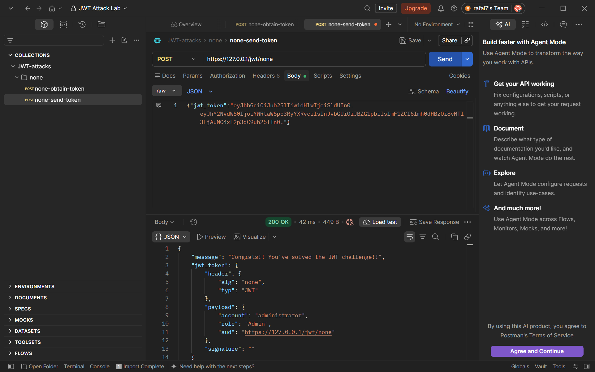

# Security by Design – Zadanie 3 – rozwiązanie (wariant Java)

Wybrano wariant w Javie (aplikacja `spring-thymeleaf-crud-example`). W ćwiczeniu są dwa
zadania: Zadanie 1 (testy jednostkowe) oraz Zadanie 2 (podatność JWT), przy czym Zadanie 2
obejmuje zarówno wykorzystanie podatności, jak i jej usunięcie. Poniżej opisano, co zostało
zrobione i jak to sprawdzono.

## Zadanie 1 – rozszerzony zestaw testów jednostkowych

Testy napisano dla klasy `com.example.thymeleaf.entity.Student`.
Plik: `Java/spring-thymeleaf-crud-example/src/test/java/com/example/thymeleaf/entity/StudentTest.java`

Przygotowano 21 testów podzielonych na cztery grupy wymagane w treści zadania:

1. **Poprawne dane** – settery i gettery, powiązanie z obiektem `Address`, `equals`/`hashCode`
   (oparte na polu `id`) oraz `toString`.
2. **Niepoprawne dane** – `null` jako imię, pusty i błędny e-mail, data urodzenia w przyszłości,
   imię złożone z samych białych znaków.
3. **Próby wstrzyknięcia SQL i JavaScript** – m.in. `Robert'); DROP TABLE student;--`,
   `' OR '1'='1`, `<script>alert('xss')</script>`, `">`.
4. **Przypadki ekstremalne** – imię o długości 100 000 znaków, znaki Unicode i emoji,
   graniczne daty `LocalDate.MIN`/`LocalDate.MAX`, znaki kontrolne, `id` równe `null`.

Encja `Student` to zwykłe POJO (Lombok) i nie ma żadnej walidacji. Zgodnie z treścią zadania
nie poprawiano definicji klasy – testy z grup 2–4 są "zielone", ale ich zadaniem jest
pokazanie, że obiekt przyjmuje niepoprawne i złośliwe dane bez żadnej walidacji ani sanityzacji.

### Zmiana w pliku Dockerfile

Aby testy uruchamiały się podczas budowania obrazu, w pliku
`Java/spring-thymeleaf-crud-example/Dockerfile` zmieniono polecenie Mavena:

- było: `RUN mvn clean install -DskipTests` (testy były pomijane),
- jest: `RUN mvn --batch-mode clean verify` (faza `verify` wykonuje fazę `test`).

Dzięki temu, jeśli którykolwiek test się nie powiedzie, Maven zwraca kod różny od zera i
`docker build` kończy się błędem – obraz wtedy nie powstaje.

Budowanie i uruchomienie aplikacji:

```shell
cd Java/spring-thymeleaf-crud-example
docker build -t thymeleaf .
docker run -it -p 8080:8080 thymeleaf
```

## Zadanie 2 – podatność JWT: wykorzystanie i poprawka

Podatność znajduje się w pliku `JWT/jwt-signature-apis-challenges/app.js`, w obsłudze
endpointu `/jwt/none` (okolice linii 34). Weryfikacja tokenu dopuszczała algorytm `none`:

```js
JWT.verify(jwt_token, secret_key, { algorithms: ['none', 'HS256'], complete: true, audience: 'https://127.0.0.1/jwt/none' }, ...)
```

Algorytm `none` oznacza token bez podpisu, więc atakujący może dowolnie zmienić zawartość
(payload) i podszyć się pod innego użytkownika.

### Przygotowany token

Zbudowano token z nagłówkiem `{"alg":"none","typ":"JWT"}` i payloadem
`{"account":"administrator","role":"Admin","aud":"https://127.0.0.1/jwt/none"}`, z pustym
podpisem i wymaganą końcową kropką:

```
eyJhbGciOiJub25lIiwidHlwIjoiSldUIn0.eyJhY2NvdW50IjoiYWRtaW5pc3RyYXRvciIsInJvbGUiOiJBZG1pbiIsImF1ZCI6Imh0dHBzOi8vMTI3LjAuMC4xL2p3dC9ub25lIn0.
```

### Przebieg ataku w Postmanie

Atak wykonano według instrukcji. W Postmanie zaimportowano kolekcję
`JWT-attacks.postman_collection.json` i skorzystano z katalogu `none`:

1. Wysłano żądanie `none-obtain-token` – otrzymano token (HS256) dla użytkownika `Bob`
   oraz endpoint `https://127.0.0.1/jwt/none`.
2. W żądaniu `none-send-token` w polu `jwt_token` wklejono token zmodyfikowany do
   `alg=none`, z kontem `administrator` i pustym podpisem (z końcową kropką), a następnie go wysłano.

W odpowiedzi otrzymano `200 OK` i komunikat
`"message": "Congrats!! You've solved the JWT challenge!!"`, w którym payload miał
`"account": "administrator"` oraz `"alg": "none"` i pusty podpis.



### Poprawka podatności

Poprawka polega na usunięciu algorytmu `none` z listy dozwolonych – dosłownie na usunięciu
`'none', ` z wywołania `JWT.verify`:

```diff
- JWT.verify(jwt_token, secret_key, { algorithms: ['none', 'HS256'], ... })
+ JWT.verify(jwt_token, secret_key, { algorithms: ['HS256'], ... })
```

Zmianę naniesiono w pliku `app.js`. Po przebudowaniu obrazu sprawdzono, że ten sam
sfałszowany token jest teraz odrzucany:

```shell
cd JWT
docker build -t jwt --platform linux/amd64 .
docker run -it -p 443:443 jwt
# ponowne wysłanie tokenu "none" zwraca teraz błąd – atak się nie udaje
```

Po poprawce odpowiedź z API to `400 Bad Request` i
`{"name":"JsonWebTokenError","message":"invalid algorithm"}`. Sprawdzono też, że zwykły
token HS256 (dla użytkownika `Bob`) nadal działa, więc poprawka nie psuje normalnego logowania.

## Weryfikacja na żywo

Oba obrazy faktycznie zbudowano i uruchomiono w Docker Desktop:

- **Zadanie 1:** podczas `docker build` wykonały się testy
  (`Tests run: 21, Failures: 0 – in com.example.thymeleaf.entity.StudentTest`, `BUILD SUCCESS`).
  Dla pewności dodano na chwilę celowo błędny test – wtedy build zakończył się `BUILD FAILURE`
  i obraz nie powstał, co potwierdza działanie mechanizmu z `Dockerfile`. Aplikacja uruchomiła się
  poprawnie (`Tomcat started on port(s): 8080`).
- **Zadanie 2 – atak:** na wersji podatnej Postman zwrócił `Congrats!!` z kontem `administrator`.
- **Zadanie 2 – poprawka:** ten sam token na wersji poprawionej zwrócił `invalid algorithm` (HTTP 400).

### Uwagi

1. **Obraz bazowy w Dockerfile (Java):** oryginalny `openjdk:11-jdk-slim` nie jest już dostępny
   na Docker Hubie (błąd `not found`), dlatego etap uruchomieniowy zmieniono na utrzymywany
   `eclipse-temurin:11-jre`. Linia realizująca zadanie (`RUN mvn --batch-mode clean verify`)
   pozostała bez zmian.
